Hi, I’m Ece Sutanrikulu. I design interfaces and build them myself, with AI as part of my toolkit.

I’m doing a Master’s in UX Design in Munich and work as a full-stack working student at IBM iX.

[Portfolio ↗](https://ecestnrkl.github.io/portfolio/) Open to work.
